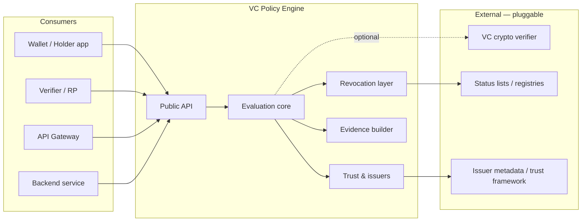
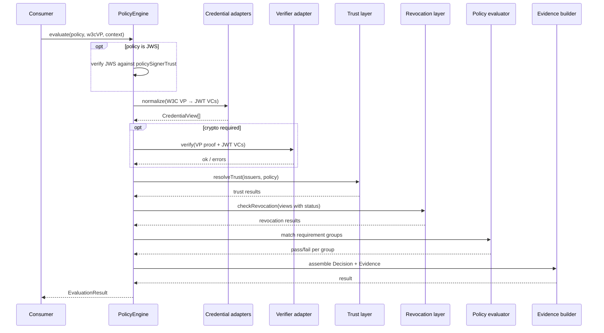

# VC Policy Engine — Design & Architecture

## 1. Executive summary

The **VC Policy Engine** is a TypeScript library that answers authorization-style questions in verifiable-credential (VC) ecosystems: given a **policy**, a set of **presented credentials**, and a **request context** (who is acting, what action, on what resource), it returns an allow/deny (or obligation-rich) **decision** together with **structured decision evidence** suitable for auditing, dispute resolution, and downstream compliance tooling.

The library is designed for embedding in wallets, verifiers, gateways, and backend services. It deliberately separates **cryptographic verification** (signatures, proofs) from **policy evaluation** (business and access rules), while orchestrating both through a single evaluation pipeline. It supports **multiple issuers** via pluggable trust and issuer metadata, and **revocation** via abstract status-list and registry providers.

MVP inputs are **JWT VCs** inside a **W3C Verifiable Presentation**. Policies are JSON documents that may be distributed as **JWS**. Allow decisions carry a **standard obligation set**. Revocation fetch failure **fails closed (`deny`)** by default.

An initial policy representation uses a small, JSON-friendly rule model. The architecture reserves extension points for **CEL** (Common Expression Language) or a compact domain-specific language (DSL) without locking consumers into a particular syntax on day one.

Decisions that lock these choices are recorded under [`docs/adr/`](adr/README.md).

---

## 2. Goals and non-goals

### 2.1 Goals

| Goal | Description |
|------|-------------|
| **Credential-aware authorization** | Express rules over credential types, claims, issuer, validity windows, and presentation bindings. |
| **Multi-issuer** | Evaluate policies against credentials from many issuers; resolve trust per policy or deployment config. |
| **Revocation awareness** | Treat revoked or suspended credentials as failing applicable policy requirements unless explicitly overridden. |
| **Decision evidence** | Emit a stable, machine-readable trace: which rules fired, which credentials matched, revocation checks, and failure reasons. |
| **Embeddable TS library** | Zero mandatory network I/O in core; async hooks for revocation and issuer metadata. |
| **Extensibility** | Plugin interfaces for VC formats (JWT VC first; SD-JWT and JSON-LD later), trust stores, and future rule engines. |

### 2.2 Non-goals (initial releases)

- Issuing credentials or running a full OID4VCI/OID4VP stack (integration only).
- Replacing a general-purpose IAM product (OPA, Cedar, etc.) — focus is VC-shaped inputs and evidence.
- Mandating on-chain trust anchors or a single global issuer registry.
- Storing long-term audit logs (consumers persist evidence).
- Human-facing policy authoring UI (out of scope for the library).
- Accepting a bare credential array as `evaluate()` input (callers wrap VCs in a W3C VP).

---

## 3. Domain glossary

| Term | Meaning in this system |
|------|-------------------------|
| **VC / VP** | Verifiable Credential / Verifiable Presentation (W3C VC Data Model). MVP: JWT VC inside a W3C VP wrapper ([ADR-0001](adr/0001-jwt-vc-first.md), [ADR-0002](adr/0002-w3c-vp-wrapper.md)). |
| **Claim** | A key-value assertion inside a credential subject (e.g. `role: "physician"`). |
| **Issuer** | Entity that signed the credential; identified by DID, `issuer` URL, or configured alias. |
| **Holder / Subject** | Party identified in the credential or presentation; may differ from the **requestor** in delegated scenarios. |
| **Policy** | Versioned JSON document defining requirements and optional obligations for a protected action or resource class. May be unsigned in-process or a JWS ([ADR-0005](adr/0005-signed-policy-documents.md)). |
| **Obligation** | Standard action the consumer must perform if it honors an allow decision (`log_access`, `step_up_auth`; [ADR-0003](adr/0003-standard-obligations.md)). |
| **Requirement** | A single match rule (credential type, claim predicate, issuer constraint, freshness, etc.). |
| **Decision** | Outcome: `allow`, `deny`, or `indeterminate` (e.g. missing data), plus metadata. |
| **Evidence** | Structured record of evaluation steps and inputs hashes for audit. |
| **Revocation** | Credential no longer valid per issuer status mechanism (status list, registry API, etc.). |

---

## 4. System context



The engine sits **after** (or alongside) presentation parsing and optional cryptographic verification. Consumers pass a **W3C Verifiable Presentation**; they may ask the engine to invoke an injected **credential verifier** adapter before policy rules run. Bare credential arrays are not a public input ([ADR-0002](adr/0002-w3c-vp-wrapper.md)).

---

## 5. High-level architecture

### 5.1 Layered design

```text
┌─────────────────────────────────────────────────────────────┐
│  Public API: PolicyEngine, types, serializers               │
├─────────────────────────────────────────────────────────────┤
│  Orchestration: EvaluationSession, pipeline, error taxonomy │
├─────────────────────────────────────────────────────────────┤
│  Policy layer: parse/validate policy, JWS verify, evaluator │
│                (future: CEL / DSL backends)                   │
├─────────────────────────────────────────────────────────────┤
│  Credential layer: W3C VP → JWT VC → CredentialView         │
├─────────────────────────────────────────────────────────────┤
│  Trust layer: IssuerRegistry, TrustPolicy, schema allowlist │
├─────────────────────────────────────────────────────────────┤
│  Revocation layer: StatusListProvider, caching, batch fetch │
├─────────────────────────────────────────────────────────────┤
│  Evidence layer: DecisionRecord, step log, redaction hooks  │
└─────────────────────────────────────────────────────────────┘
```

### 5.2 Monorepo package layout (target)

| Package | Responsibility |
|---------|----------------|
| `@vc-policy-engine/core` | Types, engine, policy model v1, evidence schema, default evaluators, JWS policy verify |
| `@vc-policy-engine/adapters-jwt` | JWT VC / JWT VP normalization (MVP format; [ADR-0001](adr/0001-jwt-vc-first.md)). May live in `core` until split. |
| `@vc-policy-engine/adapters-sd-jwt` (future) | SD-JWT VC normalization |
| `@vc-policy-engine/adapters-jsonld` (future) | JSON-LD VC normalization |
| `@vc-policy-engine/cel` (future) | CEL expression backend for requirements |
| `@vc-policy-engine/app` | Dev harness, fixtures, manual CLI (non-published) |

Current repo: `core` + `app` only; JWT adapter may start inside `core` and split when SD-JWT / JSON-LD arrive.

---

## 6. Core concepts and data models

### 6.1 Request context (`EvaluationContext`)

Everything needed to evaluate a policy besides credentials:

```typescript
interface EvaluationContext {
  /** Stable id for correlating evidence (caller-supplied). */
  requestId: string;
  /** Action being attempted, e.g. "read", "sign_contract". */
  action: string;
  /** Resource identifier or type, e.g. "record:patient:123". */
  resource?: string;
  /** Environment attributes (time, locale, channel, tenant). */
  environment?: Record<string, unknown>;
  /** Party performing the action (may link to holder DID). */
  requestor?: { id: string; idType?: string };
  /** Evaluation clock; default `new Date()` if omitted. */
  now?: Date;
}
```

### 6.2 Normalized credential view (`CredentialView`)

Internal representation after adapters run — decouples policy from wire format. MVP adapter: JWT VC extracted from a W3C VP ([ADR-0001](adr/0001-jwt-vc-first.md), [ADR-0002](adr/0002-w3c-vp-wrapper.md)).

```typescript
interface CredentialView {
  id: string;
  format: "jwt_vc" | "sd_jwt_vc" | "json_ld" | "unknown";
  types: string[];
  issuer: IssuerRef;
  issuedAt: Date;
  validFrom?: Date;
  validUntil?: Date;
  subject: Record<string, unknown>;
  status?: CredentialStatusRef;
  /** Digest of raw credential for evidence (no PII in logs by default). */
  contentBinding: string;
  raw?: unknown;
}

interface IssuerRef {
  id: string;
  idType: "did" | "url" | "alias";
}

interface CredentialStatusRef {
  type: string;
  statusListCredential?: string;
  statusListIndex?: string;
  /** Format-specific fields preserved for providers. */
  details?: Record<string, unknown>;
}
```

### 6.3 Policy document (v1 — structured rules)

Policies are versioned JSON (YAML optional via consumer). Production distribution uses a **JWS** whose payload is this document ([ADR-0005](adr/0005-signed-policy-documents.md)); unsigned objects are allowed for tests and in-process callers that already trust the policy.

Example shape:

```typescript
interface PolicyDocument {
  id: string;
  version: string;
  description?: string;
  /** Default effect if all requirement groups pass. */
  effect: "allow" | "deny";
  /**
   * Requirement groups combine with AND across groups, OR within a group
   * (at least one credential satisfies each group).
   */
  requirementGroups: RequirementGroup[];
  issuerConstraints?: IssuerConstraint[];
  /** Standard obligation types only ([ADR-0003](adr/0003-standard-obligations.md)). */
  obligations?: Obligation[];
}

interface RequirementGroup {
  id: string;
  description?: string;
  /** OR: any one requirement in the list may satisfy the group. */
  anyOf: Requirement[];
}

interface Requirement {
  credentialTypes?: string[];
  issuer?: { allow?: string[]; deny?: string[] };
  claims?: ClaimPredicate[];
  maxAge?: string; // ISO 8601 duration, e.g. "P30D"
  requireUnrevoked?: boolean; // default true when status present
}

type ObligationType = "log_access" | "step_up_auth";

interface Obligation {
  type: ObligationType;
  /** Type-specific fields (e.g. `acr` for step_up_auth). Not a free-form type. */
  params?: Record<string, unknown>;
}
```

Unknown `Obligation.type` values fail policy validation (`POLICY_INVALID`). New types require a schema version bump ([ADR-0003](adr/0003-standard-obligations.md)).

**Future (v2):** `expression: string` with CEL backend referencing `context`, `cred`, and helper functions; v1 requirements compile to CEL internally for a single execution path.

### 6.4 Decision and evidence

```typescript
type DecisionEffect = "allow" | "deny" | "indeterminate";

interface Decision {
  effect: DecisionEffect;
  policyId: string;
  policyVersion: string;
  requestId: string;
  evaluatedAt: string; // ISO timestamp
  obligations?: Obligation[];
  /** Human-oriented summary; not for automated replay. */
  summary?: string;
}

interface DecisionEvidence {
  schemaVersion: "1.0";
  decision: Decision;
  steps: EvidenceStep[];
  credentials: CredentialEvidenceRef[];
  trust: TrustEvidence[];
  revocation: RevocationEvidence[];
  /** Optional: policy hash, context hash for tamper-evident bundles. */
  bindings?: { policyDigest: string; contextDigest: string };
}

interface EvidenceStep {
  phase: "parse" | "trust" | "revocation" | "requirement" | "obligation";
  requirementGroupId?: string;
  requirementId?: string;
  outcome: "pass" | "fail" | "skip" | "error";
  reasonCode: string;
  message?: string;
  details?: Record<string, unknown>;
}
```

Reason codes are a **stable enum** (e.g. `ISSUER_NOT_TRUSTED`, `CLAIM_MISMATCH`, `CREDENTIAL_REVOKED`, `REQUIREMENT_UNSATISFIED`) so integrators can map to HTTP status, OAuth errors, or wallet UX.

---

## 7. Evaluation pipeline

### 7.1 Sequence



### 7.2 Failure semantics

- **Fail closed (default):** Untrusted issuer, failed crypto (when enabled), revoked credential, unsatisfied requirement, or **revocation fetch failure** → `deny` with explicit evidence steps ([ADR-0004](adr/0004-revocation-fail-closed.md)).
- **Revocation fetch failure:** Status present, `requireUnrevoked !== false`, and provider missing / network error / `unknown` → `deny` when `strictRevocation` is true (library **default**, including regulated deployments). Opt in to `indeterminate` with `strictRevocation: false`.
- **Partial presentation:** Requirement groups not satisfied → `deny`; evidence lists which groups failed.
- **Do not treat `deny` as “definitely revoked”:** evidence reason codes distinguish `CREDENTIAL_REVOKED` from `REVOCATION_STATUS_UNKNOWN`.

### 7.3 Performance considerations

- Batch revocation fetches per status-list URL.
- In-memory revocation cache with TTL keyed by `(statusListCredential, index)`.
- Short-circuit: first failed **mandatory** group can skip remaining groups when policy flag `failFast: true`.

---

## 8. Multi-issuer trust model

### 8.1 Issuer registry

Pluggable `IssuerRegistry` resolves issuer IDs to trust metadata:

```typescript
interface IssuerRegistry {
  resolve(issuer: IssuerRef): Promise<IssuerMetadata | null>;
}

interface IssuerMetadata {
  issuerId: string;
  displayName?: string;
  trustFramework?: string;
  acceptedCredentialTypes?: string[];
  /** JWK, DID document fragment, or reference for verifier adapter. */
  verificationMethod?: unknown;
}
```

### 8.2 Trust policies

`TrustPolicy` answers: “Is this issuer allowed for this policy / tenant?”

```typescript
interface TrustPolicy {
  isIssuerTrusted(
    issuer: IssuerRef,
    meta: IssuerMetadata | null,
    policy: PolicyDocument
  ): TrustDecision;
}

interface TrustDecision {
  trusted: boolean;
  reasonCode: string;
}
```

Built-in strategies:

1. **Allowlist** — `policy.issuerConstraints` and optional global config.
2. **Trust framework** — match `meta.trustFramework` to configured frameworks (e.g. EBSI, internal).
3. **Composite** — allowlist OR framework match (configurable).

Credentials from untrusted issuers may still appear in evidence as **rejected** with digest-only references.

---

## 9. Revocation architecture

### 9.1 Provider interface

```typescript
interface RevocationProvider {
  checkBatch(
    refs: CredentialStatusRef[]
  ): Promise<Map<string, RevocationStatus>>;
}

type RevocationStatus =
  | { state: "active" }
  | { state: "revoked"; revokedAt?: string }
  | { state: "suspended"; until?: string }
  | { state: "unknown"; error?: string };
```

Map keys: stable string from `(type, statusListCredential, index)`.

### 9.2 Implementations (planned)

| Implementation | Use case |
|----------------|----------|
| `StatusList2021Fetcher` | HTTP fetch + cache Bitstring Status List credential |
| `CachedRevocationProvider` | Decorator with TTL |
| `NoopRevocationProvider` | Treat as active when status missing; unknown when status present |

### 9.3 Interaction with requirements

- If `requireUnrevoked !== false` and credential has `status`, revocation must resolve to `active` for that credential to satisfy claim/type requirements.
- Fetch failure / `unknown` → `deny` by default (`strictRevocation: true`); `indeterminate` only when that flag is false ([ADR-0004](adr/0004-revocation-fail-closed.md)).
- Evidence always records revocation phase outcome per credential id.

---

## 10. Policy language roadmap

| Phase | Capability |
|-------|------------|
| **MVP** | JSON `Requirement` + claim predicates (`eq`, `in`, `exists`, nested paths); standard obligations `log_access`, `step_up_auth` |
| **1.1** | Duration/freshness helpers; additional obligation types via schema bump |
| **2.0** | CEL backend: compile v1 rules to CEL; expose raw CEL for advanced policies |
| **2.x** | Compact DSL (optional syntax sugar → CEL or internal AST) |

### 10.1 Claim predicates (v1)

```typescript
type ClaimPredicate =
  | { path: string; op: "eq"; value: unknown }
  | { path: string; op: "in"; values: unknown[] }
  | { path: string; op: "exists" }
  | { path: string; op: "match"; pattern: string };
```

Path syntax: JSON Pointer or dotted path (document one canonical form in API docs).

### 10.2 CEL integration (design reserve)

- **Activation record:** `context`, `credentials[]` (filtered views), `issuer`, `now`.
- **Sandbox:** No network, bounded cost, deterministic functions only.
- **Evidence:** Store CEL subexpression results as `details` on requirement steps (redacted as needed).

---

## 11. Public API (sketch)

```typescript
interface PolicyEngineConfig {
  issuerRegistry: IssuerRegistry;
  trustPolicy: TrustPolicy;
  revocationProvider: RevocationProvider;
  credentialAdapters?: CredentialAdapter[];
  credentialVerifier?: CredentialVerifier;
  evidenceRedactor?: EvidenceRedactor;
  /** Default true: revocation fetch failure → deny ([ADR-0004](adr/0004-revocation-fail-closed.md)). */
  strictRevocation?: boolean;
  /** Keys/certs trusted to sign PolicyDocument JWS ([ADR-0005](adr/0005-signed-policy-documents.md)). */
  policySignerTrust?: PolicySignerTrust;
}

interface PolicyEngine {
  evaluate(input: EvaluationInput): Promise<EvaluationResult>;
}

interface EvaluationInput {
  /** Unsigned PolicyDocument, JSON string, or JWS compact/JSON serialization. */
  policy: PolicyDocument | string;
  /** W3C Verifiable Presentation (JWT VP wrapping JWT VCs for MVP). Not a credential array. */
  presentation: unknown;
  context: EvaluationContext;
}

interface EvaluationResult {
  decision: Decision;
  evidence: DecisionEvidence;
}
```

Factory: `createPolicyEngine(config)` in `@vc-policy-engine/core`.

`PolicySignerTrust` resolves keys for policy JWS (allowlisted `kid` / DID / X.509). If `policy` is a JWS and trust is unset or verification fails → `POLICY_SIGNATURE_INVALID`. Unsigned `PolicyDocument` objects skip this step.

---

## 12. Security and privacy

| Topic | Approach |
|-------|----------|
| **PII in logs** | Evidence uses credential digests by default; `raw` omitted unless debug flag. |
| **Replay** | VP `challenge` / `nonce` plus `requestId`; evidence can record the challenge hash from the presentation ([ADR-0002](adr/0002-w3c-vp-wrapper.md)). |
| **Algorithm agility** | Verifier adapter owns suites; engine rejects credentials failing verification when adapter enabled. MVP suite: JWT / JWS. |
| **Policy integrity** | JWS-signed policies verified against `policySignerTrust` before evaluation ([ADR-0005](adr/0005-signed-policy-documents.md)). |
| **Supply chain** | Minimal dependencies; optional adapters versioned separately. |
| **Deny by default** | No implicit trust without `TrustPolicy` + policy constraints. Revocation unknowns deny unless `strictRevocation: false`. |

---

## 13. Error handling taxonomy

```typescript
class PolicyEngineError extends Error {
  code:
    | "POLICY_INVALID"
    | "POLICY_SIGNATURE_INVALID"
    | "PRESENTATION_INVALID"
    | "VERIFICATION_FAILED"
    | "INTERNAL";
  evidence?: Partial<DecisionEvidence>;
}
```

Parsing errors throw before decision; evaluation errors attach partial evidence when possible.

---

## 14. Testing strategy

| Layer | Tests |
|-------|--------|
| **Unit** | Claim predicates, requirement group logic, reason codes |
| **Contract** | Golden JWT VP + JWT VC fixtures (MVP); later formats add their own |
| **Revocation** | Mock status lists; cache; fail-closed vs lenient fetch failure |
| **Evidence** | Snapshot JSON schema; ensure stable ordering of steps |
| **Policy JWS** | Valid/invalid signatures; unsigned in-process documents still evaluate |
| **Integration** | `app` package runs end-to-end scenarios against sample W3C VPs |

Fixtures live under `packages/core/tests/fixtures/` (policy JSON/JWS, W3C VP, expected evidence).

---

## 15. Observability

- Optional `EvaluationListener` callback: `onPhaseStart`, `onPhaseEnd` for metrics (latency per phase).
- No built-in OpenTelemetry; consumers wrap `evaluate()` and export spans.

---

## 16. Versioning and compatibility

- **Policy `version`** field: semantic policy schema version, not npm version. Obligation enum changes bump this version.
- **Evidence `schemaVersion`**: bump on breaking evidence shape changes.
- Engine releases follow semver; breaking API → major bump.

Migration guides when v1 requirements map to CEL in v2 (automatic compiler where possible).

---

## 17. Implementation milestones

Work sequence, file layout, and per-milestone tests: [`implementation-guide.md`](implementation-guide.md).

| Milestone | Deliverables |
|-----------|----------------|
| **M0** (done) | Monorepo, types scaffold, greet placeholder |
| **M1** (next) | `PolicyDocument` v1, `CredentialView`, in-memory registry, evaluator without network |
| **M2** | Revocation provider + cache; strict/lenient modes |
| **M3** | Evidence schema + reason codes; golden tests; **signed policy documents (JWS)** ([ADR-0005](adr/0005-signed-policy-documents.md)) |
| **M4** | JWT VC + JWT VP adapter + verifier injection hook ([ADR-0001](adr/0001-jwt-vc-first.md), [ADR-0002](adr/0002-w3c-vp-wrapper.md)) |
| **M5** | CEL backend prototype behind feature flag |

---

## 18. Decisions (formerly open questions)

Resolved 2026-11-07. Full write-ups: [`docs/adr/`](adr/README.md).

| # | Question | Decision | ADR |
|---|----------|----------|-----|
| 1 | Canonical VC format for MVP | **JWT VC first**; SD-JWT and JSON-LD later | [0001](adr/0001-jwt-vc-first.md) |
| 2 | Presentation vs. credential array | **W3C VP wrapper** required on the public API | [0002](adr/0002-w3c-vp-wrapper.md) |
| 3 | Obligations | **Standard set**: `log_access`, `step_up_auth` | [0003](adr/0003-standard-obligations.md) |
| 4 | Indeterminate vs. deny on revocation fetch failure | **Default fail closed (`deny`)**; `indeterminate` only if `strictRevocation: false` | [0004](adr/0004-revocation-fail-closed.md) |
| 5 | Policy distribution | **Signed policy documents (JWS)** in scope for M3 | [0005](adr/0005-signed-policy-documents.md) |

---

## 19. References

- [W3C Verifiable Credentials Data Model](https://www.w3.org/TR/vc-data-model/)
- [W3C Verifiable Credentials over JWT](https://www.w3.org/TR/vc-jose-cose/)
- [W3C Bitstring Status List](https://www.w3.org/TR/vc-bitstring-status-list/)
- [Common Expression Language (CEL)](https://github.com/google/cel-spec)
- [OpenID for Verifiable Presentations](https://openid.net/specs/openid-4-verifiable-presentations-1_0.html)
- [JSON Web Signature (JWS)](https://datatracker.ietf.org/doc/html/rfc7515)

---

## Document history

| Date | Change |
|------|--------|
| 2026-11-07 | M0 marked done (scaffold verified) |
| 2026-11-07 | Linked implementation guide (M0–M5 steps) |
| 2026-11-07 | Accepted ADRs 0001–0005 (JWT VC first, W3C VP, standard obligations, fail-closed revocation, signed policies); closed former open questions |
| 2026-11-07 | Initial architecture from `requirement.md` |
